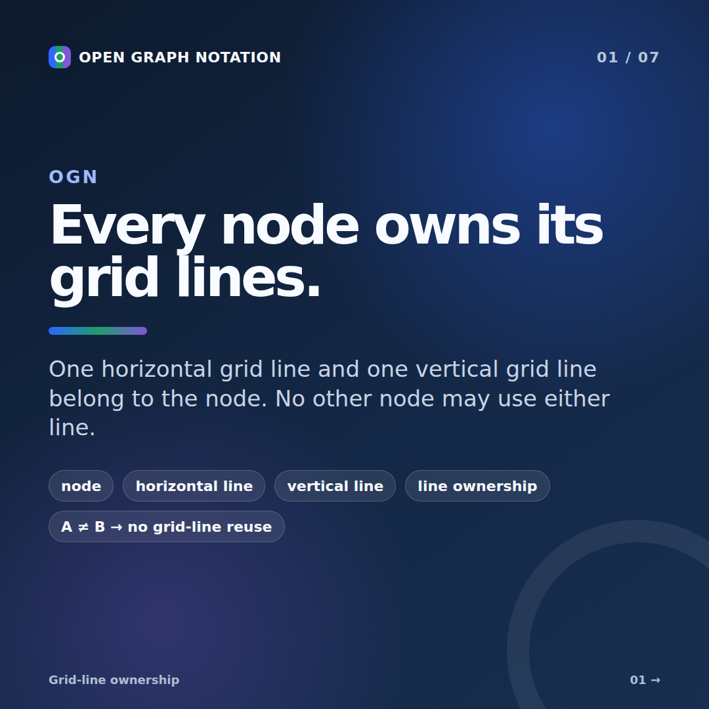
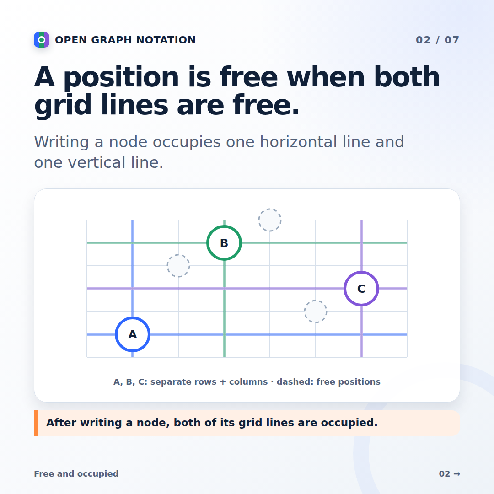
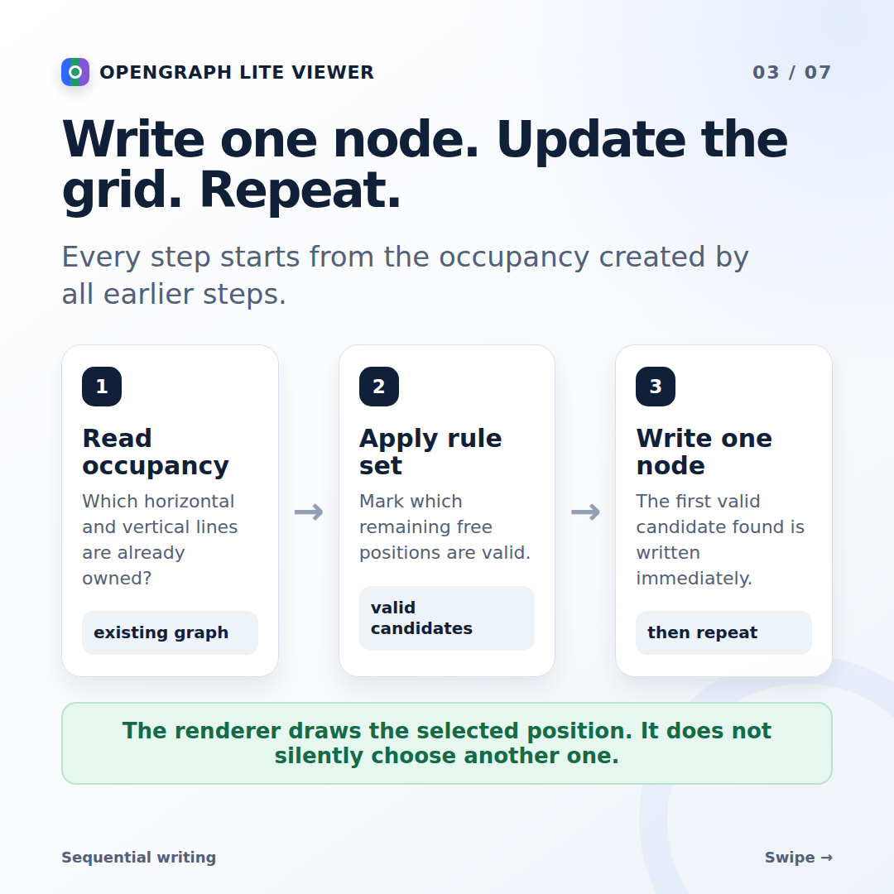
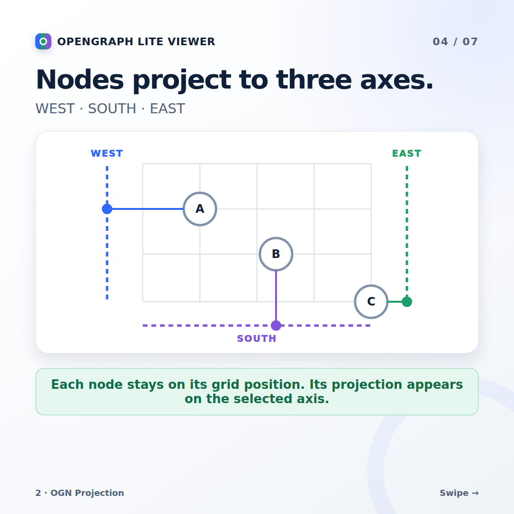
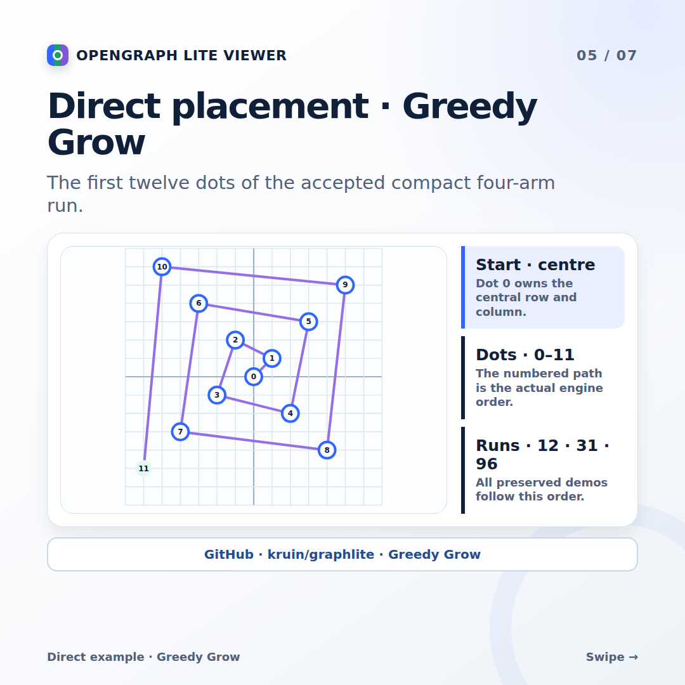
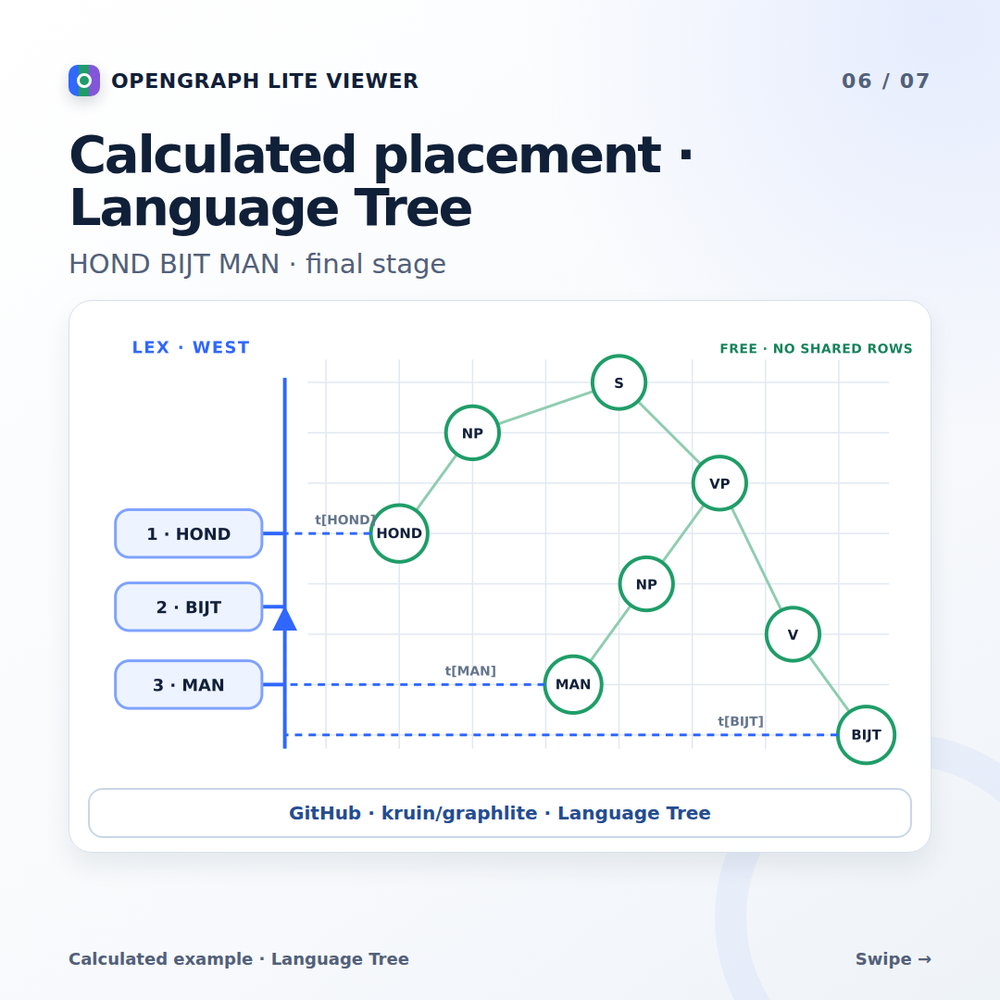
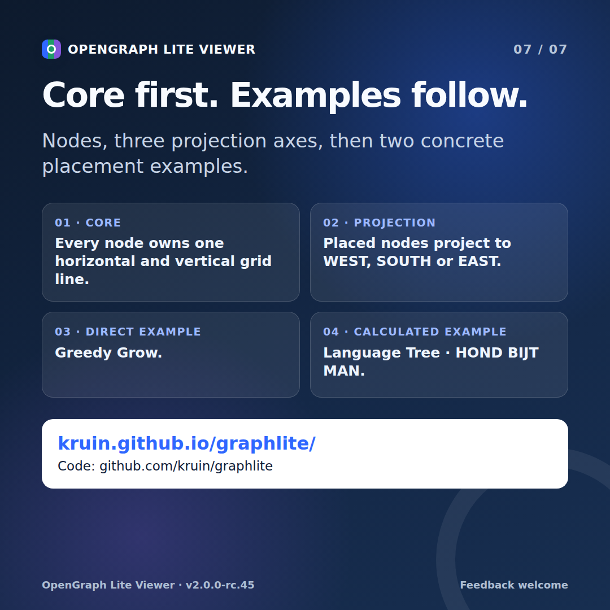

# Graphlite — LEESMIJ

Graphlite maakt de structuur én de gerealiseerde volgorde van taal zichtbaar.
Deze korte route heeft zes stappen. De ingebouwde LEESMIJ in de viewer toont
dezelfde route en bevat de carrousels.

## 1. OGN

Open Graph Notation begint met vrije plaatsing. Knopen worden één voor één op
een open grid geschreven. Iedere knoop bezit één eigen horizontale en één eigen
verticale gridlijn.

**Harde regel — A ≠ B:** verschillende knopen delen nooit een rij of kolom.

```text
A ≠ B  ⇒  x(A) ≠ x(B)  én  y(A) ≠ y(B)
```

De vaste volgorde is:

1. **OGN Free Placement** — zoek een vrije, geldige plaats;
2. **OGN Projection** — projecteer een geplaatste bronknoop;
3. **OGN Calculated Placement** — laat een toepassing eerst een plan maken.

Een ruleset bepaalt wat geldig is. Een zoekstrategie bepaalt welke vrije plaats
eerst wordt geprobeerd. Meer: [OGN-kern en plaatsing](OGN_CORE_PLACEMENT_ARCHITECTURE.md).

### Carrousel: OGN in zeven beelden

1. 
2. 
3. 
4. 
5. 
6. 
7. 

## 2. Language Tree

Language Tree is een berekende OGN-toepassing. Regels bepalen eerst de
knoopplaatsen; daarna meet de viewer vormen, labels en deelbomen.

De **volgorde van vertakking** beschrijft de structuur. De **volgorde van de
uiting** beschrijft de gerealiseerde woorden. Die twee zijn dus niet hetzelfde.
LEX bewaart de uitingsvolgorde afzonderlijk, zodat de boom niet tot
woordvolgorde wordt gereduceerd.

Met **Grammar** bekijk je dezelfde analyse als **Syntactic** of **Functional**.
Meer: [layoutcontract](RECURSIVE_LAYOUT_AND_APPLICATION_CONTRACT.md) en
[functionele analyse](FUNCTIONAL_DATABASE_COMPACT.md).

Het minimale contrastvoorbeeld **DE MUZIEK ONTROERT ANNA** houdt de syntax
gelijk (`S → NP VP`; `VP → NP V`), maar vernieuwt de functionele CLAUSE:
**DE MUZIEK** is het syntactische subject en de **STIMULUS**; **ANNA** is het
syntactische object en de **EXPERIENCER**. Subject/object en agens/patiens zijn
dus geen synoniemen. Deze keuze volgt de klassieke analyse van psychologische
predicaten met Stimulus- en Experiencerargumenten: Belletti & Rizzi (1988),
[Psych-Verbs and Theta-Theory](https://doi.org/10.1007/BF00133902).

### Tree Build reserveert verplaatsingsruimte

De builder reserveert vooraf horizontale ruimte voor vertakkingen en verticale
ruimte voor LEX-doelen. Daardoor ontstaat bij `HOND BIJT MAN` geen
schijnverplaatsing:

| woord | bron en resultaat |
|---|---|
| HOND | blijft op HOND-hoogte; geen pijl |
| BIJT | gaat naar de vrije V2-rij; verticale LEX-pijl |
| MAN | blijft op MAN-hoogte; geen pijl |

Alle verplaatsingspijlen blijven uitsluitend op de LEX-as.

## 3. LEX, SYNT en LOG

- **LEX** toont de gerealiseerde woordvolgorde in blauw. Iedere paginalaad
  begint op West; cache en projectconfig mogen Oost, Noord of Zuid niet als
  startstand herstellen. Die standen blijven tijdens de sessie beschikbaar.
  Dit geldt lokaal en op GitHub Pages.
- **SYNT** toont syntactische categorieën en regels in groen.
- **LOG** ordent S, O en V op vaste paarse slots.

Meer: [LEX-richtingen](LEX_AXIS_ORIENTATIONS.md).

## 4. Uitingen en anaforen

Een **uiting** bestaat uit één of meer gekoppelde kernzinnen. Iedere kernzin
blijft afzonderlijk een geldige OGN. In *Ik zie een man. Hij draagt een hoed.*
is MAN het antecedent en HIJ de anafoor. De complete bomen blijven star; alleen
de tweede boom schuift totdat MAN en HIJ één kolom delen.

Flip spiegelt een boom alleen wanneer verticale anafoorrelaties dat vereisen.
LEX bepaalt daarna de gerealiseerde uiting. Meer:
[uitingen en kernzinnen](UITING_EN_KERNZINNEN.md) en
[multi-OGN](MULTI_OGN_ANAPHOR.md).

Een werkwoordclusterflip is alleen beschikbaar in een input met
**bijzinsvolgorde** en een echte syntactische `V-CLUSTER`, bijvoorbeeld met
`dat`, `omdat` of `hoewel`. Klik op de `V-CLUSTER`-knoop zelf om zijn twee
dochters te verwisselen: `OMDAT VROUW TRUI HEEFT GEBREID ↔ OMDAT VROUW TRUI
GEBREID HEEFT`. Er staat geen afzonderlijke flipknop naast de input.

De werkwijze is: **input → syntactische analyse → gereconstrueerde LEX-uiting**.
In de beginstand reconstrueert LEX de input. Een flip wijzigt eerst de
V-CLUSTER-subboom; LEX wordt daarna opnieuw uit die boom afgeleid. SYN toont de
gewijzigde structuur. Functional en LOG blijven gelijk zolang functies,
rollen en interpretatie niet veranderen. Een hoofdzin en een enkelvoudige
vorm zoals `BEET` krijgen geen clusterflip. Anafoorreferenten veranderen nooit
door deze actie.

### Recap: algemene Flip en V-CLUSTER-flip

- Een **algemene Flip** is een grafische keuze voor een bestaande binaire
  subboom. Hij verwisselt links/rechts of kort/lang, maar behoudt knoop-ID's,
  ouder-kindrelaties, syntactische categorieën, functionele rollen en LEX.
- Zo'n Flip is uitvoerbaar wanneer de doelknoop minstens twee dochters heeft,
  de opnieuw berekende boom aan de OGN-vrijheidsregel blijft voldoen en
  vereiste externe relaties — vooral verticale anaforen — behouden blijven.
- Bij gekoppelde kernzinnen mag daarom soms alleen één complete kernboom
  worden vertaald of geflipt; een losse deelboomflip die een vereiste
  anafoorkolom verbreekt wordt afgewezen.
- De **V-CLUSTER-flip** is anders: hij verwisselt de echte syntactische
  clusterdochters en verandert daardoor ook de uit V-CLUSTER afgeleide
  LEX-volgorde. Hij is alleen actief bij een werkelijk meerledig V-cluster in
  een bijzin waarvan beide volgorden als testalternatief zijn vastgelegd.

## 5. Bediening

1. Kies een voorbeeld onder **Testmateriaal**.
2. Kies **Grammar: Syntactic** of **Functional**.
3. Gebruik **Play**, vorige, volgende, **Reset** en **FIT**.

**Mobiele MAX** past de relevante graph in het scherm; de inhoud wordt niet
anders geanalyseerd. Op iPhone en iPad gebruik je de publieke HTTPS-URL.

### Zelf downloaden en lokaal gebruiken

De eenvoudigste versie staat online op
[kruin.github.io/graphlite](https://kruin.github.io/graphlite/); daarvoor hoef
je niets te installeren. Wil je Graphlite op je eigen Windows-computer
gebruiken, volg dan deze korte route:

**Directe download:** [Graphlite · main.zip](https://github.com/kruin/graphlite/archive/refs/heads/main.zip)

1. Klik op de downloadlink hierboven.
2. Kies in Verkenner **Alles uitpakken**. Start de app nooit vanuit het nog
   ingepakte ZIP-bestand.
3. Open de uitgepakte map `graphlite-main` en dubbelklik op
   `start_local_viewer.bat`.
4. Laat het servervenster open zolang je Graphlite gebruikt. De starter opent
   de app in je browser op een lokaal adres.

Voor lokaal starten is Python 3 nodig. Ontbreekt Python, installeer het dan via
[python.org](https://www.python.org/downloads/windows/) en kies tijdens de
installatie **Add Python to PATH**. Open `index.html` niet rechtstreeks: de
lokale server is nodig om configuratie, testmateriaal en gekoppelde bestanden
betrouwbaar te laden. Een nieuwe versie download je op dezelfde manier; pak
die uit in een nieuwe map, zodat je oude lokale map als reserve behouden blijft.

Bronnen: [Graphlite-repository](https://github.com/kruin/graphlite) en
[GitHub-uitleg over broncode-archieven](https://docs.github.com/en/repositories/working-with-files/using-files/downloading-source-code-archives).

De GitHub-ZIP bevat ook de volledige gecontroleerde SQLite-database, de
bronnen en `PROJECT_MEMORY.md`. Daardoor kan dezelfde ZIP als overdracht naar
een nieuwe ChatGPT-chat dienen, mits alle lokale wijzigingen eerst zijn
gepusht. ChatGPT-accountgeheugen en de inhoud van eerdere gesprekken zitten
niet in een repository; `PROJECT_MEMORY.md` en de daarin aangewezen
overdrachtsdocumenten vervangen dat projectgeheugen.

### Eigen aanpassingen naar GitHub sturen

De download `main.zip` is geschikt voor gebruik en overdracht, maar bevat geen
verbinding met een GitHub-repository. Wil je eigen wijzigingen publiceren, werk
dan vanuit een Git-clone:

1. Maak op GitHub een **fork** van
   [`kruin/graphlite`](https://github.com/kruin/graphlite).
2. Installeer zo nodig
   [Git voor Windows](https://git-scm.com/download/win).
3. Open Opdrachtprompt of Git Bash in de map waarin je het project wilt plaatsen
   en voer uit, met je eigen GitHub-naam:

   ```text
   git clone https://github.com/JOUW_GITHUB_NAAM/graphlite.git
   ```

4. Breng je wijzigingen aan in die gekloonde map. Kopieer zo nodig aangepaste
   bestanden uit een andere Graphlite-map naar deze clone.
5. Dubbelklik in de projectroot op `publish_checked.bat`. Geef een korte
   committekst op en meld je bij GitHub aan wanneer Git daarom vraagt. Het script
   controleert de bron, commit de wijzigingen en pusht ze naar `origin/main`.
6. Wil je ook een eigen website, kies dan in je fork **Settings → Pages → Deploy
   from a branch → main → /(root)**. Je site verschijnt vervolgens op
   `https://JOUW_GITHUB_NAAM.github.io/graphlite/`.

Gebruik voor publiceren dus de clone, niet de uitgepakte `main.zip`. Zie ook de
[GitHub-uitleg over forks](https://docs.github.com/en/pull-requests/collaborating-with-pull-requests/working-with-forks/fork-a-repo)
en [GitHub Pages-publicatie vanaf een branch](https://docs.github.com/en/pages/getting-started-with-github-pages/configuring-a-publishing-source-for-your-github-pages-site).

## 6. Meedoen en publiceren

Je hoeft geen programmeur te zijn.

- **Online testen:** noteer URL, testitem, apparaat, browser, stappen,
  verwachting en resultaat.
- **Windows lokaal testen:** pak de volledige bron-ZIP uit en start
  `localserver.bat`. Vermeld de waarde uit `SOURCE_BUILD.txt`.
- **Testmateriaal:** overleg vóór toevoegen of wijzigen. SQLite is leidend en
  gaat openbaar mee als projectbron; de online viewer toont via de publieke
  JSON alleen actieve, goedgekeurde `OK`-records.
- **Afleveringen:** één LEESMIJ-item met eigen carrousel vormt één aflevering.
  Bronvermeldingen voor tekst en beeld zijn verplicht.

Begin bij [MEEDOEN.md](MEEDOEN.md). Voor afleveringen:
[publicatiewerkwijze](AFLEVERINGEN_PUBLICEREN.md),
[planning](AFLEVERINGEN_PLANNING.md) en
[carrouselbronnen](CARROUSEL_BRONNEN.md).

## Technische verdieping

De korte route hierboven is leidend voor nieuwe gebruikers. Details blijven
beschikbaar in afzonderlijke documenten:

- [Installeren, starten en meedoen](MEEDOEN.md)
- [Config en projectconfig](config/README.md)
- [Testmateriaal beheren](TESTMATERIAAL_BEHEER.md)
- [FIT en Reset](FIT_AND_RESET.md)
- [Flip-constraints](FLIP_CONSTRAINT_SOLVER.md)
- [Sociale export](docs/SOCIAL_EXPORT.md)
- [Talige uitbreidingen](docs/TALIGE_UITBREIDINGEN.md)

### Publiceren op sociale media

SVG, LinkedIn-PNG en Play-video zijn afgeleiden van dezelfde gecontroleerde
bron. Publiceer pas na inhoudelijke, technische én visuele controle. Zie
[SOCIAL_EXPORT.md](docs/SOCIAL_EXPORT.md).

### OGN openen en bestanden exporteren

`.ogn` (**Open Graph Notation**) is het enige projectformaat dat Graphlite
zowel exporteert als opnieuw importeert. Het bewaart `metadata`, `data` en
optionele `paradata`, zodat input, boom en projecties kunnen worden
gereconstrueerd. SVG, PNG en Play-video zijn alleen export: daaruit kan de
analyse niet betrouwbaar worden teruggebouwd.

Kies onder **Config → Exportmap en uitvoer** desgewenst één map voor alle
uitvoer: OGN, SVG, PNG, video, JSON en logs. De browser vraagt zelf toestemming
en onthoudt de keuze lokaal. Zonder ondersteuning of toestemming gebruikt de
app de gewone browserdownload. **Open .ogn uit exportmap** begint waar mogelijk
in dezelfde map. Zie [OGN-opslagformaat](OGN_STORAGE_FORMAT.md).

**Snapshot opslaan** en **Snapshot openen** staan altijd naast Play. Een
snapshot is een hervatbaar OGN-werkcheckpoint: Graphlite bewaart de huidige
graph, view, recente paradata en PLAY-stap en gaat na openen vanaf die stap
verder. Voor het opslaan kies je views en recente graph-acties; de app levert
minstens drie bestandsnaamvoorstellen die je kunt kiezen en aanpassen.
Het naamvenster is aan de titelbalk versleepbaar. Klik **Snapshot openen** en
kies het bestand. Graphlite laadt het in een zelfstandig venster binnen de app;
dat venster is verplaatsbaar, schaalbaar en heeft zijn eigen PLAY-toestand. De
oorspronkelijke graph blijft behouden. Dit werkt ook op GitHub Pages: de
overdracht blijft lokaal in de browser en vraagt geen popup-toestemming.
Het bestand bevat het volledige graphmodel om verder te kunnen PLAY-en, maar
opent uitsluitend op de afzonderlijk opgeslagen zichtbare stap.

### Beperkte meerwoordige bijwoorden

De actieve, beperkte set staat gedocumenteerd in
[TALIGE_UITBREIDINGEN.md](docs/TALIGE_UITBREIDINGEN.md); de viewer analyseert
geen willekeurige ruwe invoer.

## Bronnen

Iedere aflevering vermeldt auteur, titel, jaar, vindplaats, licentie en
bewerkingsstatus van externe tekst en afbeeldingen. Eigen Graphlite-beelden
worden als eigen visualisatie aangeduid. De volledige registratie staat in
[CARROUSEL_BRONNEN.md](CARROUSEL_BRONNEN.md).
